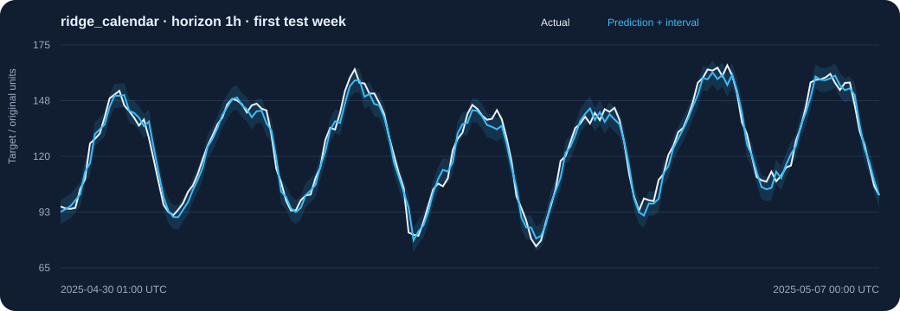

# Chronos Bench

多步时序预测实验工具，提供时间边界检查、模型比较、特征消融、残差校准区间和可追溯报告。

Python 3.11+ · NumPy / pandas / scikit-learn · MIT · CPU 运行



图中为**合成小时负荷、任意单位**：白线是真实值，蓝线是预测，阴影是独立残差校准得到的区间。

## 功能

随机拆分、滚动特征使用未来观测、跨边界多步标签和测试集调参都会使时序预测评估偏高。本工具显式记录预测时点 origin、标签时点 target、特征来源和四段时间边界，支持逐项核查评估协议。

- **三类基线、五个变体**：Seasonal naive、Ridge、HistGradientBoosting；线性/树模型各做 lag 与 lag+calendar 消融。
- **1 / 6 / 24 小时直接预测**：各 horizon 单独训练，按 horizon 清除跨块标签。
- **验证选参、独立校准**：先拟合 → 验证 → 重训，再用独立残差块估计区间，最后评估测试集。
- **完整实验产物**：配置、数据指纹、逐候选验证分数、预测 CSV、离线 HTML、SVG 预览。
- **反事实泄漏测试**：修改未来观测不应改变过去特征；修改测试标签不应改变调参结果和区间半宽。
- **真实公开数据验证**：完整 ETTh1 / OT 实验，固定上游版本与文件 SHA256，保留全部变体的聚合指标。

## 安装与运行

```bash
git clone https://github.com/cl-user-blip/chronos-bench.git
cd chronos-bench
python -m venv .venv
# Windows PowerShell: .venv\Scripts\Activate.ps1
# macOS / Linux: source .venv/bin/activate
python -m pip install -e ".[dev]"
python -m chronos_bench demo --out runs/demo
python -m pytest -q
```

直接用浏览器打开 `runs/demo/report.html`。默认演示固定种子 42，不需要外部数据或 API Key；安装依赖和可选 ETTh1 下载需要网络。

已经提交的 [默认实验 JSON](examples/demo/report.json) 和 [预测 CSV](examples/demo/predictions.csv) 可直接检查。[HTML 报告源文件](examples/demo/report.html) 需要下载后用浏览器打开，GitHub 文件页不会直接渲染 HTML。

接入自己的等间隔小时 CSV：

```csv
timestamp,y
2025-01-01T00:00:00Z,110.5
2025-01-01T01:00:00Z,108.2
```

```bash
python -m chronos_bench evaluate --csv data/load.csv --horizons 1 6 24 --out runs/load
```

至少 720 行，时间严格递增、无缺口、无重复，目标必须有限。缺失值需显式处理；程序不自动排序或插值。时间统一转 UTC，当前日历特征也按 UTC 计算。完整参数、输入约束和输出字段见 [使用说明](docs/usage.md)。

## 真实公开数据：ETTh1 / OT

来自 [zhouhaoyi/ETDataset](https://github.com/zhouhaoyi/ETDataset) 的 ETTh1，共 **17,420 行**；只使用油温 `OT`，不使用六个负荷外生变量。固定上游 commit `1d16c8f4f943005d613b5bc962e9eeb06058cf07`，原始文件 SHA256 为 `f18de3ad269cef59bb07b5438d79bb3042d3be49bdeecf01c1cd6d29695ee066`。

| 预测距离 | Seasonal MAE | 验证集选出的变体 | 该变体测试 MAE | 经验覆盖率 |
|---|---:|---|---:|---:|
| 1h | 1.696 | Ridge + calendar | 0.434 | 90.2% |
| 6h | 1.699 | Ridge + calendar | 1.053 | 91.0% |
| 24h | 1.700 | Ridge lags | 1.760 | 84.8% |

实际数值以 [完整聚合指标与来源记录](examples/etth1/metrics.json) 为准。采用本项目 55%/15%/15%/15% 时间协议，**并非 Informer 论文标准切分，不能与论文榜单直接比较**。指标按原始 OT 数值尺度计算；日历特征仅保留上游时钟值，并在本框架中按 UTC 解释，不推断实际采集时区。

24h 验证优胜模型在测试上的 MAE 高于季节基线；验证期模型选择未能泛化到该测试期。聚合报告保留全部模型与预测距离的结果。

可选联网复现：

```bash
python scripts/fetch_etth1.py --out data/etth1
python -m chronos_bench evaluate --csv data/etth1/load.csv --out runs/etth1
```

上游数据许可为 [CC BY-ND 4.0](https://github.com/zhouhaoyi/ETDataset/blob/1d16c8f4f943005d613b5bc962e9eeb06058cf07/LICENSE)，与本项目代码的 MIT 许可分开。下载器保存原始许可、校验原始字节，再在本地提取 OT 列；`data/`、`runs/` 已忽略。仓库只发布聚合评估数值，不分发 ETTh1 原始/转换数据、逐点预测或含真实数据的曲线。来源与论文致谢见 [真实数据说明](docs/etth1.md)。

## 默认离线演示：合成负荷

下面数字来自仓库内 `examples/demo/report.json`：3,360 小时合成负荷，seed=42，原始观测按 55%/15%/15%/15% 分段；Python 3.14.6、NumPy 2.4.6、pandas 3.0.3、scikit-learn 1.9.0。

| 预测距离 | Seasonal MAE | 验证集选出的变体 | 该变体测试 MAE | 区间经验覆盖率 |
|---|---:|---|---:|---:|
| 1h | 7.336 | Ridge + calendar | 2.821 | 91.5% |
| 6h | 7.379 | HistGB + calendar | 5.115 | 89.4% |
| 24h | 7.390 | Ridge + calendar | 4.423 | 88.1% |

这些是合成数据的功能验证。6h 的验证优胜模型在测试上并非最优：`ridge_calendar` 测试 MAE 为 4.820。模型选择仍以验证集为准，完整报告保留所有变体。

日历消融也不是一律有效。例如 6h Ridge 从纯滞后的 MAE 7.784 降到加入日历后的 4.820；这个结论只适用于本次数据与协议。

目标区间覆盖率设为 90%，时间相关和漂移会使经验覆盖偏离目标。当前版本**不承诺时间序列上的分布无关覆盖保证**，报告同时给出区间宽度和 interval score。

## 实验流程


预测时点 `t` 已经看到 `y[t]`，预测 `y[t+h]`。同一块内必须满足 `block_start <= origin` 且 `target < block_end`。验证/测试时随着真实观测到达逐小时滚动预测，**不是在一个固定起点预测完整测试期**。

| 输出 | 内容 |
|---|---|
| `report.json` | 数据 SHA256、环境、时间边界、搜索记录、点预测与区间指标 |
| `predictions.csv` | 每个模型/步长的 origin、target、真实值、预测、上下界 |
| `report.html` | 无 CDN 依赖的完整离线展示页 |
| `preview.svg` | 验证优胜配置的测试期首周预测图 |
| `input.csv` | `demo` 命令生成的原始合成序列 |

## 代码结构

```text
chronos_bench/
  data.py          CSV 校验与合成序列
  features.py      特征来源、时间切分与季节基线
  benchmark.py     候选拟合、验证选择、重训与评估
  metrics.py       点预测与区间指标
  report.py        HTML 报告与 SVG 预览
  __main__.py      demo / evaluate 命令
scripts/
  fetch_etth1.py   固定版本数据下载与哈希校验
tests/            协议、边界与下载器测试
examples/         合成演示产物与 ETTh1 聚合指标
```

## 测试

本地执行 `python -m pytest -q`：**22 passed**。测试覆盖因果特征、1/6/24/48h 边界清除、长于一个季节的基线、有限样本分位数、零值 WAPE、无效输入、上游校验与列转换，以及测试标签扰动下调参/校准不变性。

## 文档与范围

- [使用说明](docs/usage.md)：命令参数、CSV 数据契约、输出字段和错误处理。
- [实验设计与数据契约](docs/design.md)：清除边界、重训、区间假设与实现细节。
- [ETTh1 数据说明](docs/etth1.md)：固定版本、许可、原作者致谢与复现步骤。
- [scikit-learn 官方时间序列示例](https://scikit-learn.org/stable/auto_examples/applications/plot_time_series_lagged_features.html)：核对时间评估与 lag 特征思路。

当前版本用于单序列、小时级、rolling-origin 离线评估，不提供多序列调度、在线模型服务或 fixed-origin 预测。后续扩展包括多折扩展窗评估、滚动区间校准和分位数模型。
